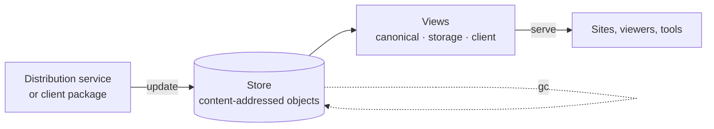

# sekai-exporter

[](https://github.com/StarMoe-org/sekai-exporter/actions/workflows/ci.yml)
[](LICENSE)
[](https://www.rust-lang.org)

[中文](README.zh-CN.md)

An exporter for Project SEKAI COLORFUL STAGE! feat. Hatsune Miku. It reads the game's Unity asset bundles and client package, converts what they hold into open formats, and keeps a published copy of every region up to date, one version after another. Every file it writes is recorded with the objects it came from, so a reader can always find out what a file is.

> [!TIP]
> - **Using the published files?** Read [Using the published assets](docs/using-the-assets.md): what each view and file is, how to link to a file so the link keeps working, and how much the audio and video lose against the game's own streams.
> - **New to the project?** Start with [Objects and assets](docs/objects-and-assets.md). It explains what exporting Unity content means, why this project converts rather than unpacks, and what it produces.

## What it produces

A version of a region is published as **views**, path trees over one shared store of objects:

| View | For | Contents |
|---|---|---|
| `canonical` | Programs that need the whole asset | Each asset in the [form](docs/spec/README.md) its runtime reads, with an [asset document](docs/spec/asset-documents.md) that names its source objects, its member files and the role of each |
| `storage` | Sites and players that read files by path | The [storage view](docs/spec/storage-view.md): the path tree of the asset storage that the Moesekai site reads, with web formats |
| `client` | Readers of what the client package holds | The images, fonts, interface prefabs and cue sheets that ship inside the package instead of being downloaded |

The files take these forms:

| Kind | Files |
|---|---|
| Images | 8-bit PNG, OpenEXR for HDR images, and in the `storage` view also lossy WebP ([texture](docs/spec/texture.md)) |
| Audio | MP3 at twice the bitrate of the HCA stream, and cue tables ([audio](docs/spec/audio.md)) |
| Video | MP4 with H.264 at one and a half times the bitrate of the MPEG-1 stream, and AAC ([video](docs/spec/video.md)) |
| Models | glTF binary with skeletons, blend shapes, materials and textures: costumes and MySekai furniture and sites ([model](docs/spec/model.md)) |
| Live2D | Cubism models with their textures, physics and motions ([Live2D](docs/spec/live2d.md)) |
| Documents | JSON for scenarios, episodes, virtual live scripts, action sets, animation curves and the other forms in the [specifications](docs/spec/README.md) |

The audio and video are encoded again from lossy sources. They are copies for listening and viewing; programs that analyse or train on the samples or pictures decode the HCA streams with `sekai-codec` and take the MPEG-1 streams out of the USM files. [Using the published assets](docs/using-the-assets.md#questions-about-audio-and-video) gives the measurements and how to repeat them.

## How it works



- **Whole assets.** A converter follows the references of an asset across bundles and writes the whole asset, such as a model with its skeleton, materials and textures.
- **Only what changed.** Every output is a pure function of content-addressed inputs. `update` fetches and converts only the bundles whose content changed, and patches the published views where they changed. Identical content is stored once across regions and versions.
- **Atomic versions.** A run writes every object before the records and state that name it, and those before the pointer of each view, so an interrupted run leaves the last version in place. Every published version stays reachable, with a [version history](docs/spec/version-history.md) and the changes since the version before.
- **Served by path.** The `serve` resolver maps the paths of a view to its objects through a [path index](docs/spec/path-index.md), so every view shares the same objects and a new version takes effect for every path at once.
- **Local or S3.** The store, the views and the state of each region live in a local directory or an S3-compatible bucket, and a run needs nothing but the site from earlier runs.
- **Pure Rust.** Decoders and the canonical encoders are written in Rust without `unsafe` code. The core builds for WebAssembly with output byte-identical to the native build.

## Quick start

Build the command-line program. The default preset converts everything the `storage` and `canonical` views need; `preset-mysekai` adds MySekai, and `full` every feature ([Features](docs/features.md)):

```bash
cargo build --release -p sekai-exporter
cargo build --release -p sekai-exporter --features preset-mysekai
```

Video is encoded by the `ffmpeg` program with `libx264`, which is not distributed with the exporter: the one `SEKAI_FFMPEG` names, or `ffmpeg` on the path.

**Convert bundles you already have:**

```bash
sekai-exporter export <bundles> <output>      # assets into <output>/store, listed in <output>/assets.tsv
sekai-exporter objects <bundles> <output>     # the object document of every bundle
```

**Keep a region up to date.** Regions are described in a configuration file and their credentials kept in a secrets directory ([Sources](docs/sources.md)):

```bash
sekai-exporter account <region> --config <file> --secrets <dir>   # once, for a region that signs in
sekai-exporter update <region> <output> --config <file> --secrets <dir> --check   # exits 1 when a new version is out
sekai-exporter update <region> <output> --config <file> --secrets <dir>
```

**Serve the views by path** ([Serving](docs/serving.md)). Each commit on `main` is also published as the image `ghcr.io/starmoe-org/sekai-exporter`:

```bash
sekai-exporter serve <output> --routes <file> --listen 127.0.0.1:8080
```

**Collect what no version refers to any more** ([Publishing](docs/publishing.md#collecting-garbage)). It only reports, until `--delete` is given:

```bash
sekai-exporter gc <output> --config <file> --secrets <dir>
```

`sekai-exporter` with no arguments prints every command and option.

## Status

In development. What works today:

| Area | State |
|---|---|
| Unpacking | `objects` writes the [object document](docs/spec/object-documents.md) of every bundle, and its field values are compared with UnityPy in continuous integration |
| Decoding | Alpha8, R8, RGB24, RGBA32, RGB565, ETC1, ETC2 RGB, ETC2 RGBA8, EAC R, crunched DXT5, ASTC LDR and ASTC HDR textures (including texture arrays and 3D textures), HCA and ADX audio, ACB and AWB archives, and USM containers |
| Encoding | PNG, lossy WebP, OpenEXR and MP3, and MP4 through the `ffmpeg` program |
| Converters | Textures, sprites, fonts, text assets, story scenes and episodes, action sets, scenario backgrounds, virtual live scripts, CRI movies and cue sheets, Live2D models and motion sets, costume parts, motions and combinations, and MySekai furniture with its attachments, sites, emoticons, character actions and talks. [Features](docs/features.md) lists what each feature converts |
| Sources | The distribution services of the `jp`, `en`, `cn`, `tw` and `kr` regions, client packages, and local directories |
| Publishing | Path indexes, index shards and path trees, version histories and changes, and directory trees, in a local directory or an S3-compatible bucket; `gc` collects what nothing refers to |
| Serving | The `serve` resolver, its HTTP server and a container image |
| WebAssembly | The core builds for `wasm32`, and continuous integration compares its object documents and its store with those of the native build byte for byte |

The [Roadmap](docs/roadmap.md) lists the state of every part and the open work.

## Documentation

The documents in [`docs/`](docs/) describe the design that the code implements.

| Document | Contents |
|---|---|
| [Using the published assets](docs/using-the-assets.md) | **For readers of the files.** Views, files, addresses, and what the audio and video lose |
| [Objects and assets](docs/objects-and-assets.md) | **Start here.** What exporting Unity content means and why this project is an exporter |
| [Architecture](docs/architecture.md) | The derivation model, evaluation strategies and the crate structure |
| [Pipeline](docs/pipeline.md) | The stages of a run and the invariant each stage keeps |
| [Sources](docs/sources.md) | Inputs, regions, version discovery and credentials |
| [Publishing](docs/publishing.md) | The store, layouts, views, the publication protocol, the state of a region and garbage collection |
| [Serving](docs/serving.md) | The `serve` resolver: path indexes, routes and HTTP responses |
| [Performance](docs/performance.md) | How the design avoids work, and where the remaining work runs |
| [Features](docs/features.md) | Crates, Cargo features and presets |
| [Specifications](docs/spec/README.md) | Every asset form and published document format |
| [Live2D motions](docs/live2d-motion.md) | How the game stores Live2D motions, and why their canonical form is the clip's curves |
| [Roadmap](docs/roadmap.md) | The state of every part, and how to pick up open work |
| [Glossary](docs/glossary.md) | Terms used throughout the documents and the code |
| [Third-party sources](docs/third-party.md) | The upstream specification, library or reference behind each component |
| [Contributing](CONTRIBUTING.md) | Where changes go, rules and checks |

## Game data

This repository contains no game data, and the exporter contains no addresses, application identifiers or client identities: each deployer supplies them in its own configuration. Inputs are read from the user's own downloads or client install, and outputs are written outside the repository. Tests use synthetic inputs.

## Acknowledgements

Much of this project's understanding of the game, part of its design, and its means of reading the client came from the five projects below. Thanks to all of them:

- **[Moe_Assets_updater_NEXT](https://github.com/StarMoe-org/Moe_Assets_updater_NEXT)**: StarMoe's asset updater, based on an early version of Haruki-Sekai-Asset-Updater, which builds the asset storage that sites read for every region. The `storage` view reproduces the layout of that storage, down to conventions such as `music/long` leaving out the `_VR` and `_SCREEN` tracks.
- **SekaiExtraRipper** and **SekaiStoryExporter** ([@TONY-All](https://github.com/TONY-All), [@SnowGlow-aww](https://github.com/SnowGlow-aww)): the first unpacks story and 3D costume assets into a lossless, versioned format, and the second renders Live2D stories from it into auto-play videos that match the game. Along the way they worked out how a story finds its assets: bundles follow the `scenarioId` of the table row, not the ID the scene data records, and area conversations replay the way the character archive does. They also settled the exact length and volume of an ACB cue, kept Live2D motions as the clip's lossless curves, and established how 3D costume parts are named and combined.
- **[moly-root](https://github.com/empty-sekai/moly-root)**: an asset extractor that works without the Unity engine and prepares the assets of [moly](https://github.com/empty-sekai/moly), a MySekai recreation. It worked out the game semantics MySekai needs to run: furniture and sites, characters and the player avatar, actions and talks, weather, performances and cameras, and the interface and its shaders. This project's furniture and site forms follow its structure; for example, attachment points come from the start and end locators paired in `_attachPoints`, and where a site sits on its floor is kept as data rather than baked into the model.
- **[ReSekai](https://github.com/MetaSekaiLab/ReSekai)** (MetaSekaiLab): a tool that rebuilds the game client as a Unity project. It decrypts the IL2CPP metadata and works out from it the serialized field layouts of the game's scripts. The `MonoBehaviour` objects of a client package carry no type trees, and this project reads them through such a table of script layouts.
- **[Haruki-Sekai-Asset-Updater](https://github.com/Team-Haruki/Haruki-Sekai-Asset-Updater)** (Team Haruki): the asset extractor and exporter that accompanies HarukiBot, with a model and architecture entirely different from this project's. Its exploration of performance offered some ideas, and its published measurements served as a reference: this project's [fused encoding](docs/performance.md) follows its practice of encoding where it decodes, which its benchmarks show cuts peak memory sharply. Checking every object a publication refers to before its pointer advances, and retrying an application version `x.y.z` that is not recognized as `x.y.0`, follow it as well.

## License

MIT, see [LICENSE](LICENSE).
