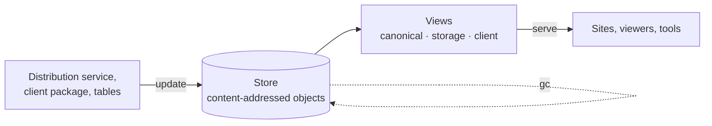

# sekai-exporter

[](https://github.com/StarMoe-org/sekai-exporter/actions/workflows/ci.yml)
[](LICENSE)
[](https://www.rust-lang.org)

[中文](README.zh-CN.md)

An exporter for Project SEKAI COLORFUL STAGE! feat. Hatsune Miku. It reads what a client holds, the downloaded Unity asset bundles of every region, the client package and the game data tables, and turns it into whole assets in open formats: images, audio, video, story scenes, Live2D models, 3D costumes, virtual lives and MySekai furniture and sites. It keeps a published copy of every region up to date, one version after another, and every file it writes says what it is and which objects it came from.

> [!TIP]
> - **Using the published files?** Read [Using the published assets](docs/using-the-assets.md): what each view and file is, how to link to a file so the link keeps working, and how much the audio and video lose against the game's own streams.
> - **New to the project?** Start with [Objects and assets](docs/objects-and-assets.md). It explains what exporting Unity content means, why this project converts rather than unpacks, and what it produces.

## What makes it different

### Whole assets, with a record of the rest

- **Assets, not object dumps.** A converter follows a root object's references across bundles and writes the whole asset, such as a costume with its skeleton, materials, textures and motions, in the form one named runtime reads. Each form has a [specification](docs/spec/README.md) that states its runtime, its contents, where it comes from and why the result is correct.
- **Every object is accounted for.** `ledger.tsv` gives, for each bundle, how many of its objects are roots of an asset, read by a conversion, of a class that carries no asset content, or unknown. A conversion that cannot produce a correct asset reports a named error instead of a guessed value, and a converter left out of the build reports `not_compiled`.
- **Each asset describes itself.** Its [asset document](docs/spec/asset-documents.md) gives its form and version, its source objects by bundle, path ID and class, each member file with its role, such as the base colour texture of a material, and the assets it refers to.

### Only the work a change needs

- **Fingerprints follow object content.** An asset's fingerprint is made of the converter name and version, the asset name, and the content hash of every object and streamed byte it reads. A read outside that closure fails with `undeclared_read`. A bundle rebuilt with the same objects changes no fingerprint.
- **Updates fetch only what changed.** `update` downloads the bundles whose declared hash changed, reuses the recorded result of every unit whose content is unchanged, and patches the published views where they differ. A new version of a converter evaluates again only the units that hold roots of its form.
- **One store for every region and version.** Objects are stored by their SHA-256 and fingerprints leave out the region, so content shared by regions or versions is stored once and converted once.
- **Reproducible bytes.** Converters and encoders read no clock and depend on no thread order or hash-map order. The same input gives the same bytes with any number of threads, under any memory budget, natively or in WebAssembly.

### Versions you can rely on

- **All or nothing.** Objects are written before the records that name them, and those before the pointer of each view, which moves only once every object it refers to is in the store. An interrupted run leaves the last version in place, and running it again continues where it stopped.
- **Every version stays reachable.** Each version keeps its own pointer, so a file can be linked by its path in one fixed version or in the current one. Publishing a version writes only the chunks of the [path index](docs/spec/path-index.md) that its changes fall in.
- **A changelog with causes.** The [version history](docs/spec/version-history.md) of each view lists the files every version added, removed and changed, and where it can be known, whether the source changed, as in a game update, or only the conversion did.
- **Runs keep no state.** The state of a region lives at its site, a local directory or an S3-compatible bucket. A machine with an empty output directory continues where the last run stopped, and on a bucket a lease lets one run write at a time.

### Pure Rust, from the command line to the browser

- Every crate forbids `unsafe` code. The unpacking, decoding and conversion crates compile to `wasm32`, and the canonical PNG, OpenEXR and MP3 encoders are written in Rust, so the WebAssembly core writes the same bytes as the native program. C libraries and external tools appear only in native builds: libwebp for lossy WebP, and the `ffmpeg` program for video. We don't know what the WebAssembly build is good for yet, but it works.
- Each step of an export is a pure function of content-addressed inputs. The command line evaluates a version ahead of time, the lazy evaluator of `sekai-pipeline` converts an asset when a request reaches it, and the WebAssembly core converts bundles held in memory; all three write the same files ([Architecture](docs/architecture.md#evaluation)).

## Measured

From our own deployment of the five regions:

- **Storage.** On 2026-11-23 the canonical views of the five regions' current versions hold 5,298,299 files, 845 GiB. The store behind them, which also holds the storage and client views and every earlier version still published, takes about 280 GiB.
- **A game update.** The English client's update from 6.1.1.0 to 6.1.50.1 on 2026-11-22 added or changed 282 of 87,900 bundles, 174 MiB of a 72 GiB version, and 1,015 files of the storage view. Converting and publishing it took about 43 minutes on a 1.5-core limit, with at most 2.4 GiB of memory.
- **Serving.** With `--threads 8`, over a storage view of 2,000,050 paths held in the page cache, `serve` answers about 43,000 requests a second for files of 1 to 256 KiB, with a 99th percentile latency of 0.8 ms at 16 connections and 11 ms at 256. It sends files of 145 MiB at 14.6 GB/s over 16 connections and stays at about 360 MiB of memory.

## What it exports

Nearly everything a client holds, from every source it is delivered by:

| Source | Supplies |
|---|---|
| `cp` | The distribution service of the `jp` and `en` regions: versions, manifests and bundles |
| `nuverse` | The distribution service of the `cn`, `tw` and `kr` regions |
| `apk` | A client package, APK or XAPK: its player data, the cue sheets of its streaming assets and the Unity bundles it ships |
| `dir` | Bundles already in a local directory |
| `tables` entry | The game data tables, from a Git repository of table dumps or a local directory |

What they hold is exported as these asset forms, each defined by its specification:

| Area | Forms |
|---|---|
| Images and text | [`texture`](docs/spec/texture.md), [`sprite`](docs/spec/sprite.md), [`text`](docs/spec/text.md), [`font`](docs/spec/font.md) |
| Sound and video | [`audio`](docs/spec/audio.md): every cue of a CRI cue sheet with its cue table; [`video`](docs/spec/video.md): CRI movies |
| Story | [`scenario`](docs/spec/scenario.md), [`scenario-background`](docs/spec/scenario-background.md), [`scenario-prefab`](docs/spec/scenario-prefab.md), [`action-set`](docs/spec/action-set.md), and [`episode`](docs/spec/episode.md): a story episode with every asset it refers to resolved |
| Live2D | [`live2d-model`, `live2d-motions`](docs/spec/live2d.md), with motions kept as the curves of their clips ([Live2D motions](docs/live2d-motion.md)) |
| 3D costumes | [`costume-model`, `costume-motion`, `costume-role`, `costume`](docs/spec/costume.md): parts, motions, every part a character of a unit can wear, and the looks of each costume |
| Virtual lives | [`virtual-live-script`](docs/spec/virtual-live-script.md), [`virtual-live-timeline`](docs/spec/virtual-live-timeline.md) |
| MySekai | [`fixture-model`](docs/spec/fixture-model.md) and [`site-model`](docs/spec/site-model.md) with materials, colliders and navigation data; [`mysekai-fixtures`](docs/spec/mysekai-fixtures.md), [`fixture-meta`, `fixture-areas`](docs/spec/fixture-areas.md), [`fixture-attach-points`](docs/spec/fixture-attach-points.md), [`fixture-reactions`](docs/spec/fixture-reactions.md), [`fixture-talks`](docs/spec/fixture-talks.md), [`talks`](docs/spec/talks.md), [`characters`](docs/spec/characters.md), [`communication-actions`](docs/spec/communication-actions.md), [`alone-actions`](docs/spec/alone-actions.md), [`emoticon`, `emoticons`](docs/spec/emoticons.md), [`facial-table`, `facial-tables`](docs/spec/facial-tables.md), [`field-camera`](docs/spec/field-camera.md), [`client-config`](docs/spec/client-config.md) |
| The client package | The `client` view: the sprites, fonts and interface prefabs of the player data, such as honor frames that no path names, and the cue sheets and bundles of the streaming assets |
| Every object | [Object documents](docs/spec/object-documents.md): the fields of every object of a bundle as JSON, with every reference resolved and large payloads alongside, including objects that no form claims yet |

The readers and decoders behind them: UnityFS bundles and serialized files with or without type trees, `MonoBehaviour` objects of a client package through a script layout table that `script-table` builds; Alpha8, R8, RGB24, RGBA32, RGB565, ETC1, ETC2 RGB, ETC2 RGBA8, EAC R, PVRTC 1, crunched DXT5, ASTC LDR and ASTC HDR textures, including texture arrays and 3D textures; HCA and ADX audio, ACB and AWB archives, and USM containers.

The files take these forms:

| Kind | Files |
|---|---|
| Images | 8-bit PNG, OpenEXR for HDR images, and in the `storage` view also lossy WebP |
| Audio | MP3 at twice the bitrate of the HCA stream, with the exact sample count and loop points, and cue tables |
| Video | MP4 with H.264 at one and a half times the bitrate of the MPEG-1 stream, and AAC |
| Models | glTF binary with skeletons, blend shapes, materials and textures, with the game's material parameters in `extras` ([model](docs/spec/model.md)) |
| Live2D | Cubism models with their textures, physics and motions |
| Documents | JSON whose `format` field names its specification |

The audio and video are encoded again from lossy sources. They are copies for listening and viewing; programs that analyse or train on the samples or pictures decode the HCA streams with `sekai-codec` and take the MPEG-1 streams out of the USM files. [Using the published assets](docs/using-the-assets.md#questions-about-audio-and-video) gives the measurements and how to repeat them.

A version of a region is published as **views**, path trees over one shared store of objects:

| View | For | Contents |
|---|---|---|
| `canonical` | Programs that need the whole asset | Each asset in its form, with its asset document |
| `storage` | Sites and players that read files by path | The [storage view](docs/spec/storage-view.md): the path tree of the asset storage that the Moesekai site reads, with web formats |
| `client` | Readers of what the client package holds | The assets the client loads from its package instead of downloading them |



## Quick start

Each release attaches the command-line program built with every feature, for Linux (x86_64 and aarch64, statically linked), Windows (x86_64) and macOS (x86_64 and arm64), with a `SHA256SUMS` file; see [Releases](https://github.com/StarMoe-org/sekai-exporter/releases). Or build it. The default preset converts everything the `storage` and `canonical` views need; `preset-mysekai` adds MySekai, and `full` every feature ([Features](docs/features.md)):

```bash
cargo build --release -p sekai-exporter
cargo build --release -p sekai-exporter --features preset-mysekai
```

Video is encoded by the `ffmpeg` program with `libx264`, which is not distributed with the exporter: the one `SEKAI_FFMPEG` names, or `ffmpeg` on the path.

**Convert bundles you already have, or a client package:**

```bash
sekai-exporter export <bundles> <output>      # assets into <output>/store, listed in <output>/assets.tsv
sekai-exporter objects <bundles> <output>     # the object document of every bundle
sekai-exporter export <package> <output> --class-table <file> --script-table <file>   # an APK or XAPK
```

**Keep a region up to date.** Regions are described in a configuration file and their credentials kept in a secrets directory ([Sources](docs/sources.md)):

```bash
sekai-exporter account <region> --config <file> --secrets <dir>   # once, for a region that signs in
sekai-exporter update <region> <output> --config <file> --secrets <dir> --check   # exits 1 when a new version is out
sekai-exporter update <region> <output> --config <file> --secrets <dir>
sekai-exporter update jp en cn tw kr <output> --config <file> --secrets <dir>   # one region after another
sekai-exporter update jp en cn tw kr <output> --config <file> --secrets <dir> --watch 60s   # look every minute, update what changed
```

**Serve the views by path** ([Serving](docs/serving.md)). Each commit on `main` is also published as the image `ghcr.io/starmoe-org/sekai-exporter`:

```bash
sekai-exporter serve <output> --routes <file> --listen 127.0.0.1:8080
```

**Collect what no version refers to any more** ([Publishing](docs/publishing.md#collecting-garbage)). It only reports, until `--delete` is given:

```bash
sekai-exporter gc <output> --config <file> --secrets <dir>
```

`sekai-exporter` with no arguments prints every command and option.

## Exporting only what you need

- **Bundles you have.** `export` converts every bundle under a directory. Include the bundles they depend on: a reference to a missing bundle fails that asset with `outside_dependencies`.
- **Part of a region.** `update` with `--only <prefix>`, given once or more, fetches and converts only the bundles whose names start with a prefix, and their dependencies. The result goes to `<output>/published` in an output directory of its own; it is not recorded as a version or sent to a bucket.

  ```bash
  sekai-exporter update jp <output> --config <file> --secrets <dir> --only live2d/model/ --only music/long/
  ```

- **Fewer converters.** A build with fewer [features](docs/features.md) converts fewer families, and lists each asset a missing converter would have produced as `not_compiled`.
- **Single files.** A site that runs `serve` gives each file by its path, in the current version or a named one, and lists a directory for a path that ends in `/` ([Using the published assets](docs/using-the-assets.md#versions-and-addresses)).

## Extending it

A new asset form is one module behind one Cargo feature, with its specification in [`docs/spec/`](docs/spec/README.md). A converter is a pure function from a root object to an asset; this is the part of the [`Converter`](crates/sekai-convert/src/lib.rs) trait that every converter writes:

```rust
pub trait Converter: Send + Sync {
    fn name(&self) -> &'static str;
    fn version(&self) -> u32;
    fn is_root(&self, object: &ObjectIndex, script: Option<&str>, container_paths: &[String]) -> bool;
    fn convert(&self, root: ObjectId, cx: &dyn Context) -> Result<Option<Asset>, ConvertError>;
    // revision, encoders, inputs, cost and files have defaults
}
```

`convert` reads objects, references and streamed bytes through the context and returns the members of the asset, each with its role: decoded content, such as an image surface or a sound, or finished bytes, such as a JSON document or a GLB file. Everything else is the framework's:

- the closure of each root across bundles, its fingerprint, and reuse of the output when the fingerprint is unchanged;
- the names of assets, the encoding of decoded content into PNG, OpenEXR, MP3, MP4 and WebP, and the asset document;
- the ledger, the catalog, the views, the publication and the version history with the cause of every change;
- scheduling within the thread and memory budget, in the native program, the lazy evaluator or WebAssembly.

The framework also holds a converter to its declarations: a read outside the closure fails with `undeclared_read`, and a member in an encoding the converter did not declare fails with `undeclared_encoder`. Raising its version evaluates again only the units that hold roots of its form.

| You want | Add |
|---|---|
| An asset made from objects | A `Converter`, with the root rule of its form in a `roots` module, so every build selects the same roots |
| An asset made from game data tables and the assets of a version, such as a story episode | A `TableConverter`: it plans its assets from the tables, and each asset is built through a context that notes every read, so an `update` keeps it while those reads give the same results |
| An asset that starts from a file of a bundle, such as a cue sheet kept as a file | A `FileConverter`, returned by the converter's `files` |
| Another layout of existing assets | A view: a function from asset documents to paths and transforms, such as the [storage view](crates/sekai-moesekai/src/storage_view.rs). A view never converts again |

Start from the object documents of the bundles you care about to see which objects make up your asset. [Adding the asset form you want](docs/objects-and-assets.md#adding-the-asset-form-you-want) walks through the steps, and [Contributing](CONTRIBUTING.md) gives the rules and checks.

## Using it as a library

The crates are layered so that each can be used on its own ([Architecture](docs/architecture.md#crates)): `sekai-unity` unpacks Unity files, `sekai-codec` decodes textures and CRI audio and video, `sekai-pipeline` evaluates a version eagerly or lazily, `sekai-serve` resolves the paths of a published view without doing any I/O of its own, so the same code can run in other hosts, and `sekai-format` holds the serde types of every published document for programs that read the output. `sekai-wasm` exposes the core to JavaScript as `evaluate` and `objects`.

## Status

In development. The [Roadmap](docs/roadmap.md) lists every part with its state, the open forms such as `AudioClip`, UI layouts, timelines and particles, and how to pick up a row.

## Documentation

The documents in [`docs/`](docs/) describe the design that the code implements.

| Document | Contents |
|---|---|
| [Using the published assets](docs/using-the-assets.md) | **For readers of the files.** Views, files, addresses, and what the audio and video lose |
| [Objects and assets](docs/objects-and-assets.md) | **Start here.** What exporting Unity content means and why this project is an exporter |
| [Architecture](docs/architecture.md) | The derivation model, evaluation strategies and the crate structure |
| [Pipeline](docs/pipeline.md) | The stages of a run and the invariant each stage keeps |
| [Sources](docs/sources.md) | Inputs, regions, version discovery and credentials |
| [Publishing](docs/publishing.md) | The store, layouts, views, the publication protocol, the state of a region and garbage collection |
| [Serving](docs/serving.md) | The `serve` resolver: path indexes, routes and HTTP responses |
| [Performance](docs/performance.md) | How the design avoids work, and where the remaining work runs |
| [Features](docs/features.md) | Crates, Cargo features and presets |
| [Specifications](docs/spec/README.md) | Every asset form and published document format |
| [Live2D motions](docs/live2d-motion.md) | How the game stores Live2D motions, and why their canonical form is the clip's curves |
| [Roadmap](docs/roadmap.md) | The state of every part, and how to pick up open work |
| [Glossary](docs/glossary.md) | Terms used throughout the documents and the code |
| [Third-party sources](docs/third-party.md) | The upstream specification, library or reference behind each component |
| [Contributing](CONTRIBUTING.md) | Where changes go, rules and checks |

## Game data

This repository contains no game data, and the exporter contains no addresses, application identifiers or client identities: each deployer supplies them in its own configuration. Inputs are read from the user's own downloads or client install, and outputs are written outside the repository. Tests use synthetic inputs.

## Acknowledgements

Much of this project's understanding of the game, part of its design, and its means of reading the client came from the five projects below. Thanks to all of them:

- **[Moe_Assets_updater_NEXT](https://github.com/StarMoe-org/Moe_Assets_updater_NEXT)**: StarMoe's asset updater, based on an early version of Haruki-Sekai-Asset-Updater, which builds the asset storage that sites read for every region. The `storage` view reproduces the layout of that storage, down to conventions such as `music/long` leaving out the `_VR` and `_SCREEN` tracks.
- **SekaiExtraRipper** and **SekaiStoryExporter** ([@TONY-All](https://github.com/TONY-All), [@SnowGlow-aww](https://github.com/SnowGlow-aww)): the first unpacks story and 3D costume assets into a lossless, versioned format, and the second renders Live2D stories from it into auto-play videos that match the game. Along the way they worked out how a story finds its assets: bundles follow the `scenarioId` of the table row, not the ID the scene data records, and area conversations replay the way the character archive does. They also settled the exact length and volume of an ACB cue, kept Live2D motions as the clip's lossless curves, and established how 3D costume parts are named and combined.
- **[moly-root](https://github.com/empty-sekai/moly-root)**: an asset extractor that works without the Unity engine and prepares the assets of [moly](https://github.com/empty-sekai/moly), a MySekai recreation. It worked out the game semantics MySekai needs to run: furniture and sites, characters and the player avatar, actions and talks, weather, performances and cameras, and the interface and its shaders. This project's furniture and site forms follow its structure; for example, attachment points come from the start and end locators paired in `_attachPoints`, and where a site sits on its floor is kept as data rather than baked into the model.
- **[ReSekai](https://github.com/MetaSekaiLab/ReSekai)** (MetaSekaiLab): a tool that rebuilds the game client as a Unity project. It decrypts the IL2CPP metadata and works out from it the serialized field layouts of the game's scripts. The `MonoBehaviour` objects of a client package carry no type trees, and this project reads them through such a table of script layouts.
- **[Haruki-Sekai-Asset-Updater](https://github.com/Team-Haruki/Haruki-Sekai-Asset-Updater)** (Team Haruki): the asset extractor and exporter that accompanies HarukiBot, with a model and architecture entirely different from this project's. Its exploration of performance offered some ideas, and its published measurements served as a reference: this project's [fused encoding](docs/performance.md) follows its practice of encoding where it decodes, which its benchmarks show cuts peak memory sharply. Checking every object a publication refers to before its pointer advances, and retrying an application version `x.y.z` that is not recognized as `x.y.0`, follow it as well.

## License

MIT, see [LICENSE](LICENSE).
