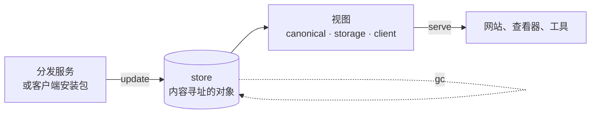

# sekai-exporter

[](https://github.com/StarMoe-org/sekai-exporter/actions/workflows/ci.yml)
[](LICENSE)
[](https://www.rust-lang.org)

[English](README.md)

面向《世界计划 彩色舞台 feat. 初音未来》（Project SEKAI COLORFUL STAGE! feat. Hatsune Miku）的导出器。它读取游戏的 Unity 资源包与客户端安装包，把其中的内容转换为开放格式，并随游戏逐个版本更新每个区服的发布副本。它写出的每个文件都记录了来源对象，读者总能查明一个文件是什么。

> [!TIP]
> - **要使用发布的文件？** 请读[使用发布的资产](docs/using-the-assets.zh-CN.md)：每种视图和文件是什么，怎样引用文件才能长期有效，以及音频与视频相对游戏原始流损失了多少。
> - **初次了解本项目？** 请从[对象与资产](docs/objects-and-assets.zh-CN.md)读起。它说明导出 Unity 内容意味着什么、本项目为何以转换而非解包为核心，以及产出哪些内容。

## 产出什么

区服的一个版本发布为若干**视图**，即建立在同一个对象 store 之上的路径树：

| 视图 | 面向 | 内容 |
|---|---|---|
| `canonical` | 需要完整资产的程序 | 每个资产按其运行时读取的[形式](docs/spec/README.zh-CN.md)写出，并附一份[资产文档](docs/spec/asset-documents.zh-CN.md)，记录来源对象、成员文件及每个文件的角色 |
| `storage` | 按路径读取文件的网站与播放器 | [storage 视图](docs/spec/storage-view.zh-CN.md)：Moesekai 网站所读取的资源存储的路径树，使用网页格式 |
| `client` | 读取客户端安装包内容的程序 | 随安装包分发、不经下载的图片、字体、界面 prefab 与 cue 表 |

文件的格式如下：

| 类别 | 文件 |
|---|---|
| 图片 | 8 位 PNG，HDR 图片为 OpenEXR；`storage` 视图另有有损 WebP（[贴图](docs/spec/texture.zh-CN.md)） |
| 音频 | 码率为 HCA 音频流两倍的 MP3，以及 cue 表（[音频](docs/spec/audio.zh-CN.md)） |
| 视频 | H.264 码率为 MPEG-1 视频流 1.5 倍的 MP4，音频为 AAC（[视频](docs/spec/video.zh-CN.md)） |
| 模型 | 带骨骼、形态键、材质与贴图的 glTF 二进制文件：服装，以及 MySekai 家具与场地（[模型](docs/spec/model.zh-CN.md)） |
| Live2D | Cubism 模型，含贴图、物理与动作（[Live2D](docs/spec/live2d.zh-CN.md)） |
| 文档 | 剧本、剧集、虚拟演唱会剧本、动作集、动画曲线，以及[规范](docs/spec/README.zh-CN.md)中其他形式的 JSON |

音频与视频是由有损来源再次编码的，是供收听与观看的副本。需要分析采样或画面、或用其训练模型的程序，应使用 `sekai-codec` 解码 HCA 流，并从 USM 文件中取出 MPEG-1 流。测量结果及复现方法见[使用发布的资产](docs/using-the-assets.zh-CN.md#关于音频与视频的问题)。

## 工作方式



- **完整的资产**：转换器跨资源包沿引用找齐一个资产，整体写出，例如带骨骼、材质与贴图的模型。
- **只处理变化的部分**：每一项输出都是以内容寻址的输入为参数的纯函数的结果。`update` 只下载并转换内容有变化的资源包，只在变化处修补已发布的视图。各区服、各版本之间相同的内容只保存一份。
- **原子的版本**：一次运行先写出所有对象，再写指明它们的记录与状态，最后写各视图的指针，因此中断的运行会保留上一个版本。每个已发布的版本都保持可达，并附有[版本历史](docs/spec/version-history.zh-CN.md)和相对上一版本的变更。
- **按路径提供**：`serve` 解析器通过[路径索引](docs/spec/path-index.zh-CN.md)把视图的路径映射到对象，所有视图共享同一批对象，新版本对所有路径同时生效。
- **本地或 S3**：store、视图和各区服的状态可以放在本地目录或 S3 兼容存储桶中，一次运行除站点本身外不需要早先运行留下的任何东西。
- **纯 Rust**：解码器与规范编码器以不含 `unsafe` 代码的 Rust 编写。核心可构建为 WebAssembly，输出与原生构建逐字节相同。

## 快速开始

构建命令行程序。默认预设转换 `storage` 与 `canonical` 视图所需的全部内容；`preset-mysekai` 另加 MySekai，`full` 包含全部 feature（[功能开关](docs/features.zh-CN.md)）：

```bash
cargo build --release -p sekai-exporter
cargo build --release -p sekai-exporter --features preset-mysekai
```

视频由 `ffmpeg` 程序以 `libx264` 编码，导出器不附带它：使用环境变量 `SEKAI_FFMPEG` 指定的程序，否则使用路径中的 `ffmpeg`。

**转换手头已有的资源包：**

```bash
sekai-exporter export <bundles> <output>      # 资产写入 <output>/store，列在 <output>/assets.tsv
sekai-exporter objects <bundles> <output>     # 每个资源包的对象文档
```

**让一个区服保持最新。** 区服在配置文件中描述，凭据保存在 secrets 目录中（[来源](docs/sources.zh-CN.md)）：

```bash
sekai-exporter account <region> --config <file> --secrets <dir>   # 需要登录的区服运行一次
sekai-exporter update <region> <output> --config <file> --secrets <dir> --check   # 有新版本时以 1 退出
sekai-exporter update <region> <output> --config <file> --secrets <dir>
```

**按路径提供视图**（[服务](docs/serving.zh-CN.md)）。`main` 上的每个提交也发布为镜像 `ghcr.io/starmoe-org/sekai-exporter`：

```bash
sekai-exporter serve <output> --routes <file> --listen 127.0.0.1:8080
```

**回收不再被任何版本引用的文件**（[发布](docs/publishing.zh-CN.md#回收垃圾)）。不加 `--delete` 时只报告：

```bash
sekai-exporter gc <output> --config <file> --secrets <dir>
```

不带参数运行 `sekai-exporter` 会列出所有命令和选项。

## 状态

开发中。目前可用的部分：

| 方面 | 状态 |
|---|---|
| 解包 | `objects` 为每个资源包写出[对象文档](docs/spec/object-documents.zh-CN.md)，其字段值在持续集成中与 UnityPy 相比对 |
| 解码 | Alpha8、R8、RGB24、RGBA32、RGB565、ETC1、ETC2 RGB、ETC2 RGBA8、EAC R、crunch DXT5、ASTC LDR 与 ASTC HDR 贴图（含贴图数组与 3D 贴图），HCA 与 ADX 音频，ACB 与 AWB 归档，以及 USM 容器 |
| 编码 | PNG、有损 WebP、OpenEXR 与 MP3，以及经 `ffmpeg` 程序写出的 MP4 |
| 转换器 | 贴图、精灵、字体、文本资产、剧情场景与剧集、动作集、剧情背景、虚拟演唱会剧本、CRI 视频与 cue 表、Live2D 模型与动作集、服装部件、动作与组合，以及 MySekai 家具及其附件、场地、表情、角色动作与对话。[功能开关](docs/features.zh-CN.md)列出了每个 feature 转换什么 |
| 来源 | `jp`、`en`、`cn`、`tw`、`kr` 区服的分发服务，客户端安装包，以及本地目录 |
| 发布 | 路径索引、索引分片与路径树，版本历史与变更，以及目录树，目标为本地目录或 S3 兼容存储桶；`gc` 回收无人引用的文件 |
| 服务 | `serve` 解析器、它的 HTTP 服务器与容器镜像 |
| WebAssembly | 核心可构建为 `wasm32`，持续集成会把它写出的对象文档和 store 与原生构建的逐字节比对 |

[路线图](docs/roadmap.zh-CN.md)列出了每个部分的状态和尚未完成的工作。

## 文档

[`docs/`](docs/) 中的文档描述了代码所实现的设计。

| 文档 | 内容 |
|---|---|
| [使用发布的资产](docs/using-the-assets.zh-CN.md) | **写给文件的读者。** 视图、文件、地址，以及音频与视频的损失 |
| [对象与资产](docs/objects-and-assets.zh-CN.md) | **从这里开始。** 导出 Unity 内容的含义，以及本项目定位为导出器的原因 |
| [架构](docs/architecture.zh-CN.md) | 派生模型、求值策略与 crate 结构 |
| [管线](docs/pipeline.zh-CN.md) | 一次运行的各个阶段及每个阶段保持的不变式 |
| [来源](docs/sources.zh-CN.md) | 输入、区服、版本发现与凭据 |
| [发布](docs/publishing.zh-CN.md) | store、布局、视图、发布协议、区服的状态与垃圾回收 |
| [服务](docs/serving.zh-CN.md) | `serve` 解析器：路径索引、路由与 HTTP 响应 |
| [性能](docs/performance.zh-CN.md) | 设计如何避免工作，以及其余工作在何处运行 |
| [功能开关](docs/features.zh-CN.md) | crate、Cargo feature 与预设 |
| [规范](docs/spec/README.zh-CN.md) | 每种资产形式与每种发布文档格式的规范 |
| [Live2D 动作](docs/live2d-motion.zh-CN.md) | 游戏如何保存 Live2D 动作，以及其规范形式为何是 clip 的曲线 |
| [路线图](docs/roadmap.zh-CN.md) | 每个部分的状态，以及如何认领未完成的工作 |
| [术语表](docs/glossary.md) | 文档与代码中统一使用的术语 |
| [第三方来源](docs/third-party.zh-CN.md) | 每个组件所依据的上游规范、库或参考实现 |
| [贡献指南](CONTRIBUTING.zh-CN.md) | 改动的位置、规则与检查 |

## 游戏数据

本仓库不包含任何游戏数据，导出器本身也不含任何地址、应用标识或客户端身份，这些由部署者在自己的配置中提供。输入读取自使用者自行下载的内容或安装的客户端，输出写在仓库之外。测试使用合成输入。

## 许可

MIT，参见 [LICENSE](LICENSE)。
