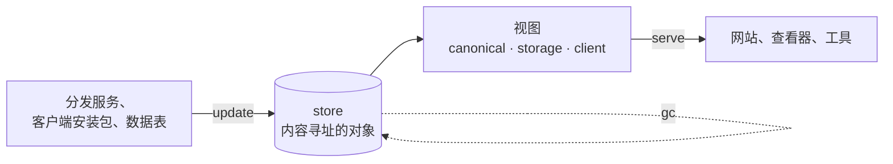

# sekai-exporter

[](https://github.com/StarMoe-org/sekai-exporter/actions/workflows/ci.yml)
[](LICENSE)
[](https://www.rust-lang.org)

[English](README.md)

面向《世界计划 彩色舞台 feat. 初音未来》（Project SEKAI COLORFUL STAGE! feat. Hatsune Miku）的导出器。它读取客户端所持有的内容，即各区服下载的 Unity 资源包、客户端安装包与游戏数据表，并把它们转换为开放格式的完整资产：图片、音频、视频、剧情场景、Live2D 模型、3D 服装、虚拟演唱会，以及 MySekai 的家具与场地。它随游戏逐个版本更新每个区服的发布副本，写出的每个文件都说明自己是什么、来自哪些对象。

> [!TIP]
> - **要使用发布的文件？** 请读[使用发布的资产](docs/using-the-assets.zh-CN.md)：每种视图和文件是什么，怎样引用文件才能长期有效，以及音频与视频相对游戏原始流损失了多少。
> - **初次了解本项目？** 请从[对象与资产](docs/objects-and-assets.zh-CN.md)读起。它说明导出 Unity 内容意味着什么、本项目为何以转换而非解包为核心，以及产出哪些内容。

## 有何不同

### 完整的资产，其余部分都有记录

- **导出资产，而非倾倒对象**：转换器跨资源包沿根对象的引用找齐一个资产，按某个明确运行时读取的形式整体写出，例如带骨骼、材质、贴图与动作的服装。每种形式都有一份[规范](docs/spec/README.zh-CN.md)，写明它的运行时、内容、来源，以及结果为何正确。
- **每个对象都有交代**：`ledger.tsv` 为每个资源包列出其对象中有多少是资产的根、被转换读取、属于不含资产内容的类，或是未知。无法产出正确资产的转换会报告一个具名错误，而不是写入猜测的值；未编译进构建的转换器会报告 `not_compiled`。
- **每个资产自带说明**：它的[资产文档](docs/spec/asset-documents.zh-CN.md)记录形式与版本、以资源包、path ID 与类标识的来源对象、每个成员文件及其角色（例如某个材质的基础色贴图），以及它引用的其他资产。

### 只做变化所需的工作

- **指纹跟随对象内容**：资产的指纹由转换器名称与版本、资产名，以及它所读取的每个对象和每段流式数据的内容哈希组成。读取闭包以外的内容会以 `undeclared_read` 失败。资源包重新打包而对象不变时，指纹都不变。
- **更新只下载变化的部分**：`update` 只下载声明哈希有变化的资源包，内容不变的单元直接取用记录的结果，并只修补已发布视图中有差异的地方。转换器发布新版本时，只有含该形式根对象的单元会重新求值。
- **所有区服与版本共用一个 store**：对象以 SHA-256 存储，指纹不含区服，因此区服之间、版本之间相同的内容只存一份，也只转换一次。
- **可复现的字节**：转换器与编码器不读取时钟，也不依赖线程顺序或哈希表顺序。同样的输入，无论多少线程、内存预算多少、原生还是 WebAssembly，都得到相同的字节。

### 可以信赖的版本

- **全有或全无**：先写对象，再写指明它们的记录，最后写各视图的指针；只有当指针引用的每个对象都已在 store 中，指针才会前移。中断的运行会保留上一个版本，再次运行即从中断处继续。
- **每个版本都保持可达**：每个版本都有自己的指针，因此可以按某个固定版本中的路径引用文件，也可以按当前版本中的路径引用。发布一个版本只写入[路径索引](docs/spec/path-index.zh-CN.md)中其变化所落入的块。
- **带原因的变更记录**：每个视图的[版本历史](docs/spec/version-history.zh-CN.md)列出每个版本新增、删除和改变的文件；在原因可知时，还说明是来源变了（如游戏更新），还是只有转换变了。
- **运行本身不保存状态**：区服的状态保存在它的站点，即本地目录或 S3 兼容存储桶。输出目录为空的机器也能从上次运行停下的地方继续；使用存储桶时，租约保证同一时间只有一次运行写入。

### 纯 Rust，从命令行到浏览器

- 每个 crate 都禁止 `unsafe` 代码。解包、解码与转换 crate 可编译为 `wasm32`，规范的 PNG、OpenEXR 与 MP3 编码器以 Rust 编写，因此 WebAssembly 核心写出的字节与原生程序相同。C 语言库与外部工具只出现在原生构建中：有损 WebP 用 libwebp，视频用 `ffmpeg` 程序。我们还不知道 WebAssembly 构建有什么用，但是它可以。
- 导出的每一步都是以内容寻址的输入为参数的纯函数。命令行预先求值一个版本，`sekai-pipeline` 的惰性求值器在请求到达时转换一个资产，WebAssembly 核心在内存中转换资源包；三者写出相同的文件（[架构](docs/architecture.zh-CN.md#求值)）。

## 实测

来自我们自己部署的五个区服：

- **存储**：2026-11-23，五个区服当前版本的 canonical 视图共有 5,298,299 个文件，845 GiB。背后的 store 同时容纳 storage、client 视图和所有仍在发布的较早版本，占用约 280 GiB。
- **一次游戏更新**：英文客户端 2026-11-22 从 6.1.1.0 更新到 6.1.50.1，87,900 个资源包中新增或改变了 282 个，在 72 GiB 的版本中占 174 MiB，storage 视图中有 1,015 个文件随之变化。转换与发布用时约 43 分钟，限额 1.5 个核心，内存最多 2.4 GiB。
- **服务**：`serve` 以 `--threads 8` 运行，面对一个 2,000,050 条路径、文件都在页缓存中的 storage 视图，对 1 至 256 KiB 的文件每秒约应答 43,000 次请求，第 99 百分位延迟在 16 个连接时为 0.8 ms，256 个连接时为 11 ms。145 MiB 的文件在 16 个连接下以 14.6 GB/s 发出，内存保持在约 360 MiB。

## 导出什么

几乎是客户端所持有的一切，覆盖它的每一种分发来源：

| 来源 | 提供 |
|---|---|
| `cp` | `jp` 与 `en` 区服的分发服务：版本、清单与资源包 |
| `nuverse` | `cn`、`tw` 与 `kr` 区服的分发服务 |
| `apk` | 客户端安装包（APK 或 XAPK）：其 player data、streaming assets 中的 cue 表，以及随包分发的 Unity 资源包 |
| `dir` | 本地目录中已有的资源包 |
| `tables` 条目 | 游戏数据表，来自数据表转储的 Git 仓库或本地目录 |

其中的内容导出为以下资产形式，每种形式都由其规范定义：

| 方面 | 形式 |
|---|---|
| 图片与文本 | [`texture`](docs/spec/texture.zh-CN.md)、[`sprite`](docs/spec/sprite.zh-CN.md)、[`text`](docs/spec/text.zh-CN.md)、[`font`](docs/spec/font.zh-CN.md) |
| 声音与视频 | [`audio`](docs/spec/audio.zh-CN.md)：CRI cue 表中的每个 cue 及其 cue 表；[`video`](docs/spec/video.zh-CN.md)：CRI 视频 |
| 剧情 | [`scenario`](docs/spec/scenario.zh-CN.md)、[`scenario-background`](docs/spec/scenario-background.zh-CN.md)、[`scenario-prefab`](docs/spec/scenario-prefab.zh-CN.md)、[`action-set`](docs/spec/action-set.zh-CN.md)，以及 [`episode`](docs/spec/episode.zh-CN.md)：解析出其引用的全部资产的剧集 |
| Live2D | [`live2d-model`、`live2d-motions`](docs/spec/live2d.zh-CN.md)，动作保留为 clip 的曲线（[Live2D 动作](docs/live2d-motion.zh-CN.md)） |
| 3D 服装 | [`costume-model`、`costume-motion`、`costume-role`、`costume`](docs/spec/costume.zh-CN.md)：部件、动作、某团体某角色可穿戴的全部部件，以及每套服装的造型 |
| 虚拟演唱会 | [`virtual-live-script`](docs/spec/virtual-live-script.zh-CN.md)、[`virtual-live-timeline`](docs/spec/virtual-live-timeline.zh-CN.md) |
| MySekai | 带材质、碰撞体与导航数据的 [`fixture-model`](docs/spec/fixture-model.zh-CN.md) 与 [`site-model`](docs/spec/site-model.zh-CN.md)；[`mysekai-fixtures`](docs/spec/mysekai-fixtures.zh-CN.md)、[`fixture-meta`、`fixture-areas`](docs/spec/fixture-areas.zh-CN.md)、[`fixture-attach-points`](docs/spec/fixture-attach-points.zh-CN.md)、[`fixture-reactions`](docs/spec/fixture-reactions.zh-CN.md)、[`fixture-talks`](docs/spec/fixture-talks.zh-CN.md)、[`talks`](docs/spec/talks.zh-CN.md)、[`characters`](docs/spec/characters.zh-CN.md)、[`communication-actions`](docs/spec/communication-actions.zh-CN.md)、[`alone-actions`](docs/spec/alone-actions.zh-CN.md)、[`emoticon`、`emoticons`](docs/spec/emoticons.zh-CN.md)、[`facial-table`、`facial-tables`](docs/spec/facial-tables.zh-CN.md)、[`field-camera`](docs/spec/field-camera.zh-CN.md)、[`client-config`](docs/spec/client-config.zh-CN.md) |
| 客户端安装包 | `client` 视图：player data 中的精灵、字体与界面 prefab（例如没有路径指名的称号边框），以及 streaming assets 中的 cue 表与资源包 |
| 每个对象 | [对象文档](docs/spec/object-documents.zh-CN.md)：资源包中每个对象的字段，以 JSON 写出，所有引用都已解析，大块载荷另存，尚无形式认领的对象也在其中 |

背后的读取器与解码器：带或不带 type tree 的 UnityFS 资源包与 SerializedFile，以及经 `script-table` 构建的脚本布局表读取的客户端安装包中的 `MonoBehaviour` 对象；Alpha8、R8、RGB24、RGBA32、RGB565、ETC1、ETC2 RGB、ETC2 RGBA8、EAC R、PVRTC 1、crunch DXT5、ASTC LDR 与 ASTC HDR 贴图（含贴图数组与 3D 贴图）；HCA 与 ADX 音频，ACB 与 AWB 归档，以及 USM 容器。

文件的格式如下：

| 类别 | 文件 |
|---|---|
| 图片 | 8 位 PNG，HDR 图片为 OpenEXR；`storage` 视图另有有损 WebP |
| 音频 | 码率为 HCA 音频流两倍的 MP3，保留精确的采样数与循环点，以及 cue 表 |
| 视频 | H.264 码率为 MPEG-1 视频流 1.5 倍的 MP4，音频为 AAC |
| 模型 | 带骨骼、形态键、材质与贴图的 glTF 二进制文件，游戏的材质参数保存在 `extras` 中（[模型](docs/spec/model.zh-CN.md)） |
| Live2D | Cubism 模型，含贴图、物理与动作 |
| 文档 | JSON，其 `format` 字段指明对应的规范 |

音频与视频是由有损来源再次编码的，是供收听与观看的副本。需要分析采样或画面、或用其训练模型的程序，应使用 `sekai-codec` 解码 HCA 流，并从 USM 文件中取出 MPEG-1 流。测量结果及复现方法见[使用发布的资产](docs/using-the-assets.zh-CN.md#关于音频与视频的问题)。

区服的一个版本发布为若干**视图**，即建立在同一个对象 store 之上的路径树：

| 视图 | 面向 | 内容 |
|---|---|---|
| `canonical` | 需要完整资产的程序 | 每个资产按其形式写出，附资产文档 |
| `storage` | 按路径读取文件的网站与播放器 | [storage 视图](docs/spec/storage-view.zh-CN.md)：Moesekai 网站所读取的资源存储的路径树，使用网页格式 |
| `client` | 读取客户端安装包内容的程序 | 客户端从安装包中加载、不经下载的资产 |



## 快速开始

每个发布版本都附带带全部 feature 构建的命令行程序，覆盖 Linux（x86_64 与 aarch64，静态链接）、Windows（x86_64）和 macOS（x86_64 与 arm64），并附 `SHA256SUMS` 文件，见 [Releases](https://github.com/StarMoe-org/sekai-exporter/releases)。也可以自行构建。默认预设转换 `storage` 与 `canonical` 视图所需的全部内容；`preset-mysekai` 另加 MySekai，`full` 包含全部 feature（[功能开关](docs/features.zh-CN.md)）：

```bash
cargo build --release -p sekai-exporter
cargo build --release -p sekai-exporter --features preset-mysekai
```

视频由 `ffmpeg` 程序以 `libx264` 编码，导出器不附带它：使用环境变量 `SEKAI_FFMPEG` 指定的程序，否则使用路径中的 `ffmpeg`。

**转换手头已有的资源包或客户端安装包：**

```bash
sekai-exporter export <bundles> <output>      # 资产写入 <output>/store，列在 <output>/assets.tsv
sekai-exporter objects <bundles> <output>     # 每个资源包的对象文档
sekai-exporter export <package> <output> --class-table <file> --script-table <file>   # APK 或 XAPK
```

**让一个区服保持最新。** 区服在配置文件中描述，凭据保存在 secrets 目录中（[来源](docs/sources.zh-CN.md)）：

```bash
sekai-exporter account <region> --config <file> --secrets <dir>   # 需要登录的区服运行一次
sekai-exporter update <region> <output> --config <file> --secrets <dir> --check   # 有新版本时以 1 退出
sekai-exporter update <region> <output> --config <file> --secrets <dir>
sekai-exporter update jp en cn tw kr <output> --config <file> --secrets <dir>   # 逐个更新多个区服
sekai-exporter update jp en cn tw kr <output> --config <file> --secrets <dir> --watch 60s   # 每分钟检查一次，更新有变化的区服
```

**按路径提供视图**（[服务](docs/serving.zh-CN.md)）。`main` 上的每个提交也发布为镜像 `ghcr.io/starmoe-org/sekai-exporter`：

```bash
sekai-exporter serve <output> --routes <file> --listen 127.0.0.1:8080
```

**回收不再被任何版本引用的文件**（[发布](docs/publishing.zh-CN.md#回收垃圾)）。不加 `--delete` 时只报告：

```bash
sekai-exporter gc <output> --config <file> --secrets <dir>
```

不带参数运行 `sekai-exporter` 会列出所有命令和选项。

## 只导出需要的部分

- **手头已有的资源包**：`export` 转换一个目录下的所有资源包。把它们依赖的资源包一起放进去：引用到缺失资源包的资产会以 `outside_dependencies` 失败。
- **区服的一部分**：`update` 加上 `--only <prefix>`（可给多次），只下载并转换名称以这些前缀开头的资源包及其依赖。结果发布在单独输出目录的 `<output>/published` 下，不记为一个版本，也不发往存储桶。

  ```bash
  sekai-exporter update jp <output> --config <file> --secrets <dir> --only live2d/model/ --only music/long/
  ```

- **更少的转换器**：用更少的[功能开关](docs/features.zh-CN.md)构建，转换的类别也更少；缺少的转换器本应产出的每个资产都以 `not_compiled` 列出。
- **单个文件**：运行 `serve` 的站点按路径提供每个文件，可以取当前版本或指定版本；以 `/` 结尾的路径给出目录列表（[使用发布的资产](docs/using-the-assets.zh-CN.md#版本与地址)）。

## 扩展

一种新的资产形式就是一个模块加一个 Cargo feature，再在 [`docs/spec/`](docs/spec/README.zh-CN.md) 中附上它的规范。转换器是从根对象到资产的纯函数，下面是 [`Converter`](crates/sekai-convert/src/lib.rs) trait 中每个转换器都要写的部分：

```rust
pub trait Converter: Send + Sync {
    fn name(&self) -> &'static str;
    fn version(&self) -> u32;
    fn is_root(&self, object: &ObjectIndex, script: Option<&str>, container_paths: &[String]) -> bool;
    fn convert(&self, root: ObjectId, cx: &dyn Context) -> Result<Option<Asset>, ConvertError>;
    // revision, encoders, inputs, cost and files have defaults
}
```

`convert` 通过上下文读取对象、引用与流式数据，返回资产的成员及每个成员的角色：解码后的内容（如图像表面或声音），或已完成的字节（如 JSON 文档或 GLB 文件）。其余一切都由框架完成：

- 每个根对象跨资源包的闭包、它的指纹，以及指纹不变时对输出的复用；
- 资产命名，把解码内容编码为 PNG、OpenEXR、MP3、MP4 与 WebP，以及资产文档；
- 账目（ledger）、目录、视图、发布，以及标明每处变化原因的版本历史；
- 在线程与内存预算内的调度，无论在原生程序、惰性求值器还是 WebAssembly 中。

框架还会让转换器遵守它的声明：读取闭包以外的内容以 `undeclared_read` 失败，写出未声明编码的成员以 `undeclared_encoder` 失败。提升转换器的版本，只有含该形式根对象的单元会重新求值。

| 需求 | 添加 |
|---|---|
| 由对象构成的资产 | 一个 `Converter`，其形式的根规则放在 `roots` 模块中，使每种构建都选出相同的根 |
| 由游戏数据表与版本中已有资产构成的资产，例如剧集 | 一个 `TableConverter`：它先依据数据表规划资产，每个资产再通过记下每次读取的上下文构建，因此只要这些读取给出相同的结果，`update` 就能保留它 |
| 以资源包中某个文件为起点的资产，例如以文件形式保存的 cue 表 | 一个 `FileConverter`，由转换器的 `files` 返回 |
| 现有资产的另一种布局 | 一个视图：从资产文档到路径与变换的函数，例如 [storage 视图](crates/sekai-moesekai/src/storage_view.rs)。视图从不重新转换 |

先导出你关心的资源包的对象文档，看清哪些对象组成了你要的资产。[加入新的资产形式](docs/objects-and-assets.zh-CN.md#加入新的资产形式)逐步说明了做法，[贡献指南](CONTRIBUTING.zh-CN.md)给出了规则与检查。

## 作为库使用

各 crate 分层组织，每一个都可以单独使用（[架构](docs/architecture.zh-CN.md#crate)）：`sekai-unity` 解包 Unity 文件，`sekai-codec` 解码贴图与 CRI 音视频，`sekai-pipeline` 以预先或惰性的方式求值一个版本，`sekai-serve` 解析已发布视图的路径而自身不做任何 I/O，因此同一份代码可以运行在其他宿主中，`sekai-format` 则提供每种发布文档的 serde 类型，供读取输出的程序使用。`sekai-wasm` 把核心以 `evaluate` 与 `objects` 暴露给 JavaScript。

## 状态

开发中。[路线图](docs/roadmap.zh-CN.md)列出了每个部分的状态、尚未定型的形式（如 `AudioClip`、UI 布局、时间轴与粒子），以及如何认领其中一项。

## 文档

[`docs/`](docs/) 中的文档描述了代码所实现的设计。

| 文档 | 内容 |
|---|---|
| [使用发布的资产](docs/using-the-assets.zh-CN.md) | **写给文件的读者。** 视图、文件、地址，以及音频与视频的损失 |
| [对象与资产](docs/objects-and-assets.zh-CN.md) | **从这里开始。** 导出 Unity 内容的含义，以及本项目定位为导出器的原因 |
| [架构](docs/architecture.zh-CN.md) | 派生模型、求值策略与 crate 结构 |
| [管线](docs/pipeline.zh-CN.md) | 一次运行的各个阶段及每个阶段保持的不变式 |
| [来源](docs/sources.zh-CN.md) | 输入、区服、版本发现与凭据 |
| [发布](docs/publishing.zh-CN.md) | store、布局、视图、发布协议、区服的状态与垃圾回收 |
| [服务](docs/serving.zh-CN.md) | `serve` 解析器：路径索引、路由与 HTTP 响应 |
| [性能](docs/performance.zh-CN.md) | 设计如何避免工作，以及其余工作在何处运行 |
| [功能开关](docs/features.zh-CN.md) | crate、Cargo feature 与预设 |
| [规范](docs/spec/README.zh-CN.md) | 每种资产形式与每种发布文档格式的规范 |
| [Live2D 动作](docs/live2d-motion.zh-CN.md) | 游戏如何保存 Live2D 动作，以及其规范形式为何是 clip 的曲线 |
| [路线图](docs/roadmap.zh-CN.md) | 每个部分的状态，以及如何认领未完成的工作 |
| [术语表](docs/glossary.md) | 文档与代码中统一使用的术语 |
| [第三方来源](docs/third-party.zh-CN.md) | 每个组件所依据的上游规范、库或参考实现 |
| [贡献指南](CONTRIBUTING.zh-CN.md) | 改动的位置、规则与检查 |

## 游戏数据

本仓库不包含任何游戏数据，导出器本身也不含任何地址、应用标识或客户端身份，这些由部署者在自己的配置中提供。输入读取自使用者自行下载的内容或安装的客户端，输出写在仓库之外。测试使用合成输入。

## 致谢

本项目对游戏语义的还原、一部分设计与读取客户端的能力，来自以下五个项目，在此致谢：

- **[Moe_Assets_updater_NEXT](https://github.com/StarMoe-org/Moe_Assets_updater_NEXT)**：StarMoe 基于 Haruki-Sekai-Asset-Updater 早期版本维护的资源更新器，为各区服生成网站读取的资源存储。`storage` 视图复现的正是这份存储的布局，包括 `music/long` 不收录 `_VR` 与 `_SCREEN` 音轨这样的约定。
- **SekaiExtraRipper** 与 **SekaiStoryExporter**（[@TONY-All](https://github.com/TONY-All)、[@SnowGlow-aww](https://github.com/SnowGlow-aww)）：前者把剧情与 3D 服装资源解包为无损、带版本的格式，后者据此把 Live2D 剧情渲染成与游戏一致的自动播放视频。为此它们理清了剧情如何找到它的资源：资源包按数据表中的 `scenarioId` 定位，而非剧本自身记录的 ID；区域对话按角色档案的方式回放。它们还确定了 ACB cue 的精确时长与音量、Live2D 动作应保留为 clip 的无损曲线，以及 3D 服装部件的命名与组合规则。
- **[moly-root](https://github.com/empty-sekai/moly-root)**：不依赖 Unity 引擎的资源提取工具，为 MySekai 复刻运行时 [moly](https://github.com/empty-sekai/moly) 准备资源。它还原了 MySekai 运行所需的游戏语义，涵盖家具与场地、角色与玩家形象、动作与对话、天气、演出与镜头、界面与着色器。本项目的家具与场地形式沿用了它的结构，例如挂接位置取自 `_attachPoints` 中成对的起止定位点，场地在楼层中的位置作为数据保存而不烘焙进模型。
- **[ReSekai](https://github.com/MetaSekaiLab/ReSekai)**（MetaSekaiLab）：把游戏客户端还原为 Unity 工程的工具。它解密 IL2CPP 元数据，并由此推出游戏脚本的序列化字段布局。客户端包里的 `MonoBehaviour` 不带 type tree，本项目正是依靠这样一张脚本布局表读取它们。
- **[Haruki-Sekai-Asset-Updater](https://github.com/Team-Haruki/Haruki-Sekai-Asset-Updater)**（Team Haruki）：HarukiBot 配套的资源提取与导出工具，模型与架构和本项目完全不同。它在性能上的探索提供了一些思路，公开的实测数据也带来了一定参考：本项目的[融合编码](docs/performance.zh-CN.md)借鉴了它在解码处就地编码的做法，其基准显示这一做法大幅降低了峰值内存。发布前逐一复核所引用的对象、应用版本 `x.y.z` 不被识别时改用 `x.y.0`，同样借鉴自它。

## 许可

MIT，参见 [LICENSE](LICENSE)。
